# AKUNDA V12: how the engine is built

A twin-turbo V12 drawn with hand-written WebGL: no three.js, no 3D models. Every part is generated in code when the
module loads, put into one vertex buffer, and placed each frame by a list of draw commands.

### Animations

One four-stroke cycle each, 720° of the crankshaft, drawn by the engine's own renderer: cold air in blue, hot exhaust gas
in orange, and the flame in each cylinder at its firing angle. The frames are evenly spaced over the cycle, so the loops
have no seam.

| | |
| --- | --- |
| 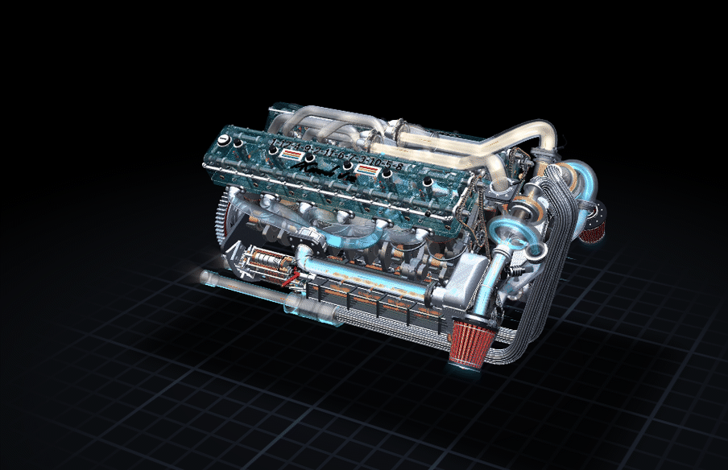 | 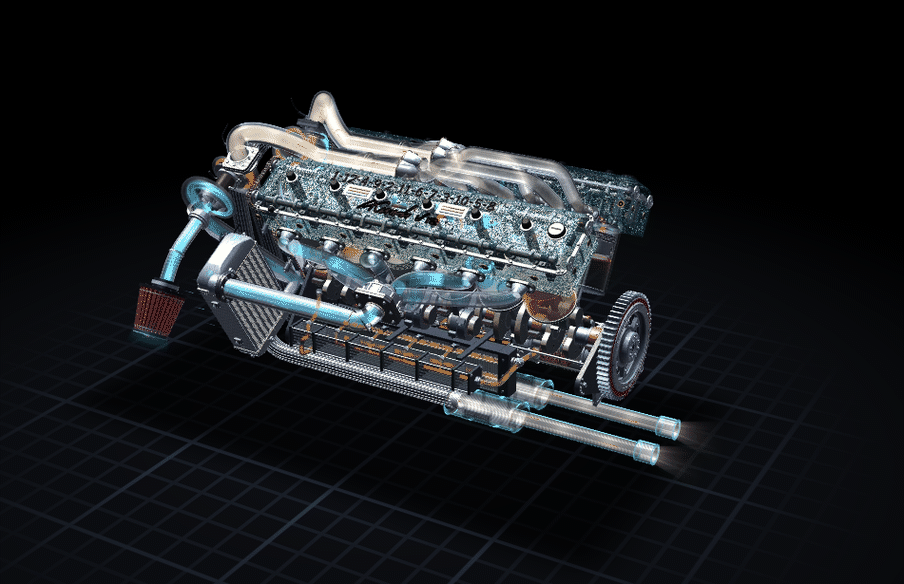 |
| **Three quarters.** The starter's side: the intake collector and its runners, the dry sump and oil cooler below, the turbos and intercoolers at the right. | **The other side.** Turned round: the second bank, the intercoolers at the left. |
| 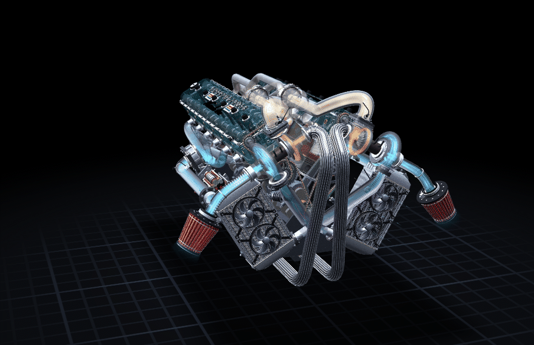 | 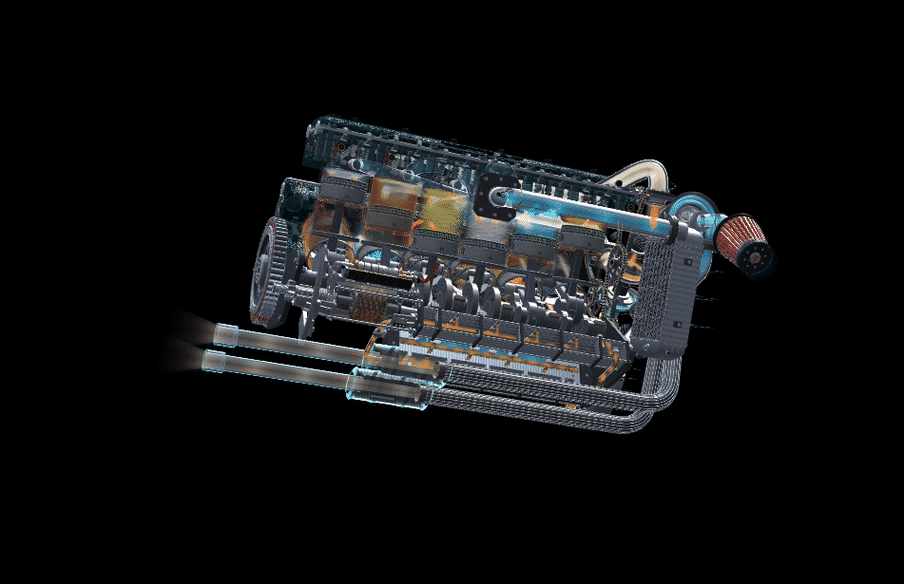 |
| **From a little in front.** The intercoolers' twin fans, the turbos, the ribbed exhaust pipes, the timing drive. | **From below, one side.** 30 degrees under the level: the dry sump's pumps and oil cooler, the exhaust and silencers. |
| 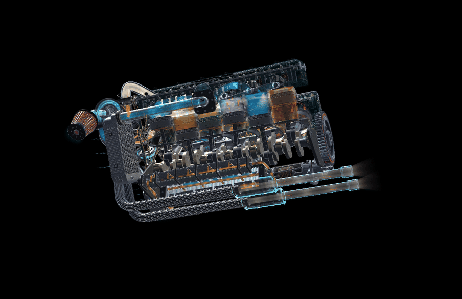 | 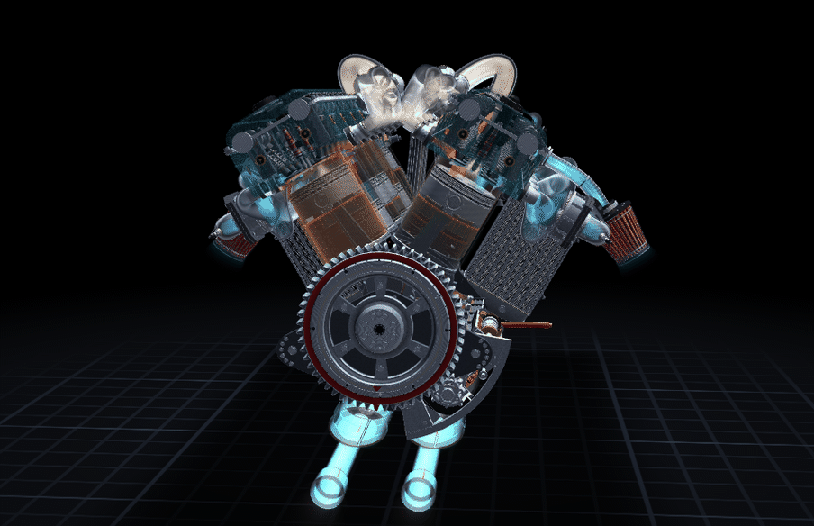 |
| **From below, the other side.** The same, from the other bank's side. | **From behind.** Square on to the flywheel, a little from above. |

### Stills

| | |
| --- | --- |
| 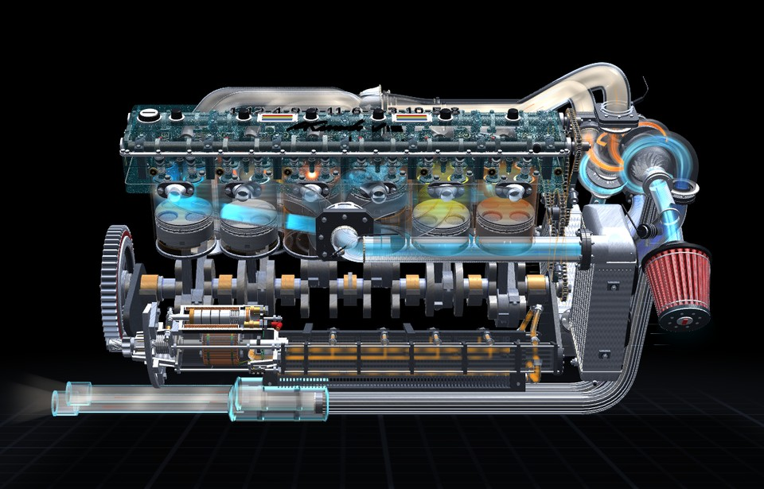 | 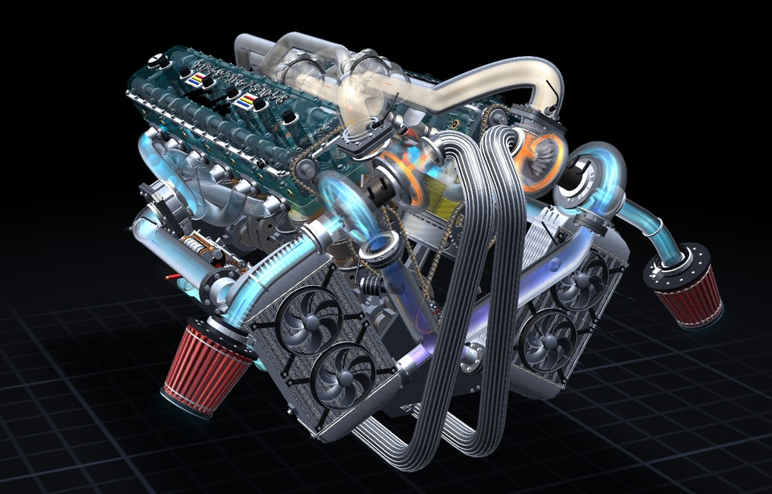 |
| **Side.** Pistons in the aluminium bores, the intake collector and runners, the dry sump, the starter. | **Turbo.** A turbo at the front, its air filter, its intercooler and the pipes to it. |
| 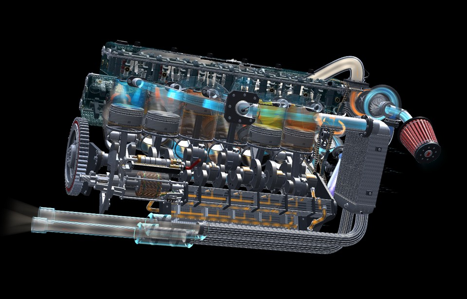 | 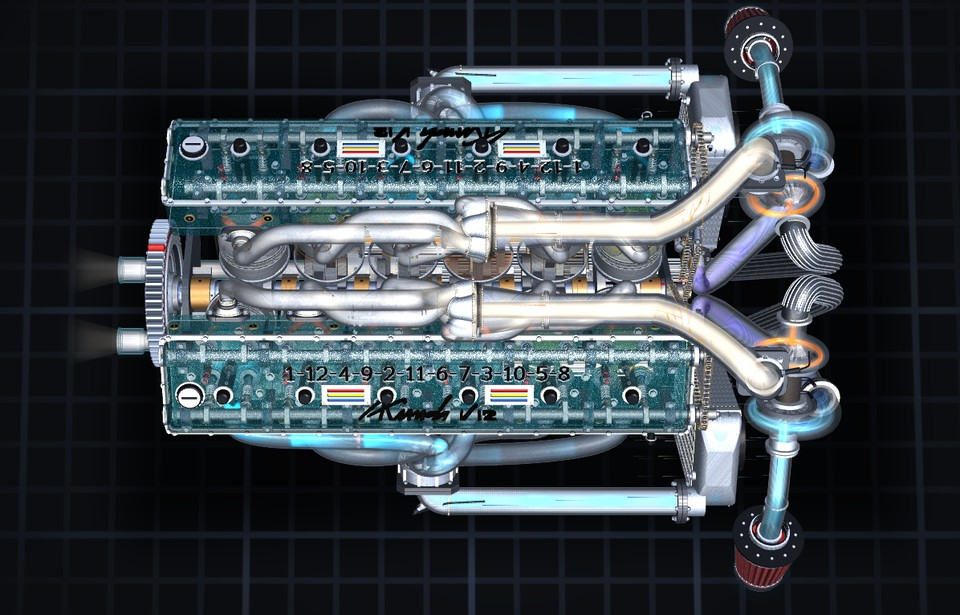 |
| **Starter's side.** From a little below: the cut-away starter at the ring gear, its motor wound all round. | **Top.** Both heads solid from above, the exhaust runners and collectors in the V. |
| 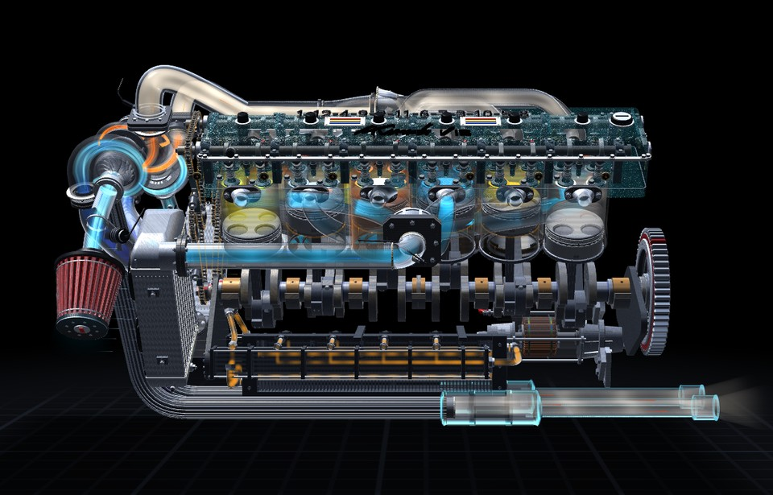 | 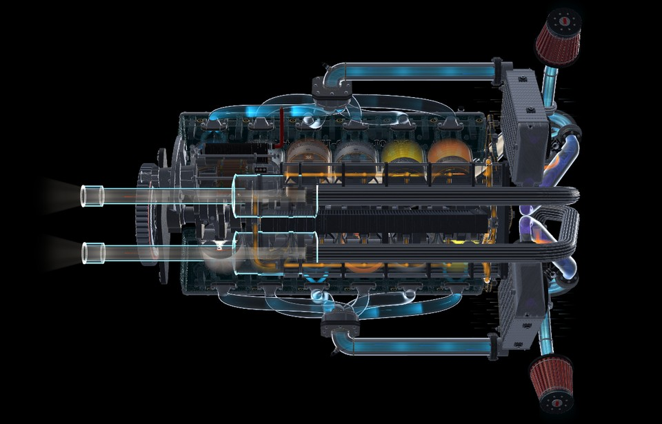 |
| **The other bank.** In profile, from the side opposite the starter's view. | **From below.** The dry sump's pumps and oil cooler, the two exhaust pipes and silencers. |
| 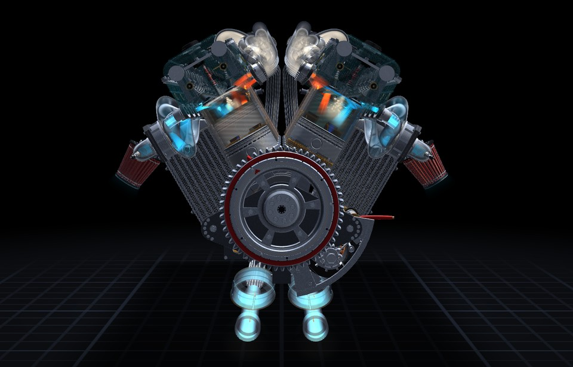 | 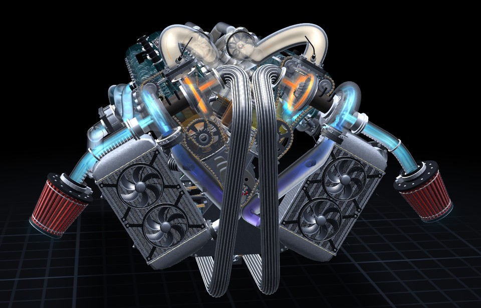 |
| **From behind.** The flywheel and the ring gear, straight on. | **Timing drive.** From the front, turned a little: the chains bare (their covers show only when opaque). |
| 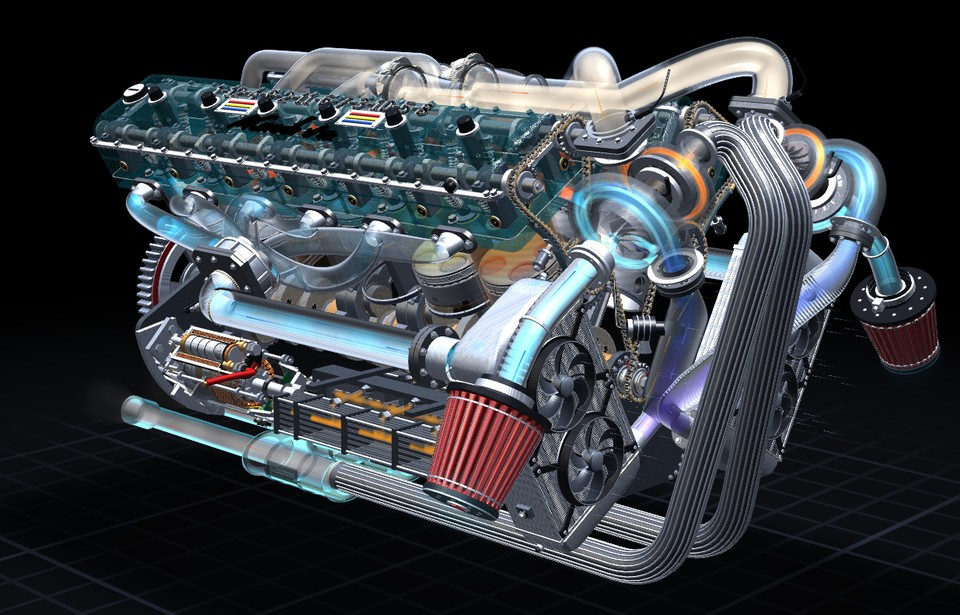 | 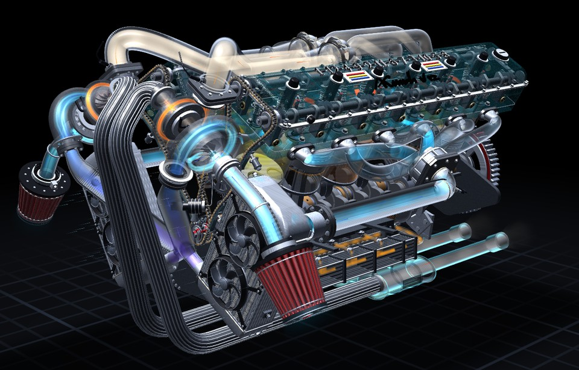 |
| **Front left.** Turned 45 degrees from the front. | **Front right.** Turned 45 degrees the other way. |

The starter's motor is an induction motor: a squirrel-cage rotor with skewed bars, and a stator that is not cut, wound
toroidally all the way round, its coils' turns running along the slots and back along its outside, seen through the
see-through yoke, taped in their phases' colours; a speed sensor and three phase leads. On the solid engine the starter
is whole, closed.

The stills are all framed alike: the whole engine, centred, filling the same share of the frame, 960 by 615. The images
are in `docs/`. They are rendered from the code, see-through and with the airflow on, so they need to be made again when the engine's look changes.

## Checking a change

```
npx tsc --noEmit                        # types, strict
```

Every change is also checked, outside this project, against a saved reference: the whole engine is built in Node and
every part's geometry, the draw commands on four frames of the cycle and the effects (charge, flame, spark, fuel spray,
airflow) are compared with it. A refactor must come out identical; a change meant to alter the engine shows exactly
which parts it altered.

## Frames and units

- **The engine's frame**: X along the crankshaft (timing chains at -X, flywheel at +X), **Y down** (the crankshaft's
  axis is 0, the heads are above it at negative Y), Z across the engine.
- **One unit** is about one pixel of the drawing the engine began as: the bore is 133, the stroke radius `R` 54,
  the rod `L` 204. The rods were 159; they were lengthened so that the two pistons on a crank pin, one from each
  bank, never touch at the bottom of the V, and so that a piston stays wholly in its bore at the bottom of its stroke;
  everything above the pistons rose by `ROD_LIFT` (45) along each bore. The piston is 65 tall: its crown 40 above the
  wrist pin, its skirt 25 below it.
- **The cylinder**: a glass tube exactly the bore (the piston's own size), with a thin ring round its foot that marks
  the bore; round it, faint and grey, the liner's wall, which stops 16 short of the bore's foot so that the two banks'
  walls stay clear of each other in the V.
- **A bank's own frame**: each bank is a straight six built upright, as if it stood alone, and turned into place.
  The V is 60°: bank A (cylinders 7 to 12) is turned by +30°, bank B (1 to 6) by -30°, one the mirror image of the
  other, so both have the exhaust in the valley and the intake outside. `bankPoint(bank, x, y, z)` maps a point of a
  bank's frame into the engine's.
- **A turbocharger module's frame**: the collector, the turbocharger and the air intake are built together in one
  frame; `modulePoint(m, p)` maps it into the engine's (`mesh/exhaust.ts`).
- **The lettering** (`mesh/headText.ts`): the firing order and the signature AKUNDA V12 are cut deep into each head's
  cover as continuous grooves (a grid of depths: `carveText`, `stampSignature`), black at the floor, the walls white, for contrast; drawn with a depth offset of the groove's depth, so they show on the cover and nowhere else.
- **The hot V, two turbochargers at the front.** Each bank's exhaust leaves the head on the valley side. At each port the
  pipe starts as an oval cone, the port's own shape, on a dark metal flange (`MAT_EXH_GUNMETAL`) held by two detailed
  bolts (`portFlare`, `flangeBolt`). Its six thick runners (`EXHAUST_RUNNERS`, narrowed at the ports like a throat,
  `runnerRadius`) run on lanes of their own in the V, beside the heads and never above their tops, into the back of a
  collector in the V, one cylinder ahead of the bank's middle (`MID`); the rear ones rise out of their ports in an S and
  come straight forward, with no loop. The welds on these pipes show only their visible half (`SEEN`). From the collector
  one pipe runs straight forward, then rises in an arch and comes down in an arch, square onto a level rounded-square
  flange on top of the turbine's housing, its lower plate cast with the housing, eight bolts (`INLET_MOUTH`,
  `INLET_FACING`, `roundedSquare`, `buildTurboFeed`). These pipes are grey metal, more solid than glass
  (`HOT_PIPE_OPACITY`), so that the gas shows in them but the heads behind are veiled.
- **The turbochargers** (`MODULES`, `MODULE_IN_BANK`) stand at the front, ahead of the timing drive, each leaning with its
  bank: shaft across the bank, turbine on the valley side, compressor on the intake side. Both housings are one cast
  grey metal with a fine matte grain (`MAT_TURBO_GRAIN`), see-through so the wheels show; no wastegate actuator. The
  compressor draws through a duct that turns only 20 degrees (`FILTER_TURN`) to a K&N-style filter standing clear of the
  intercooler.
- **The exhaust after the turbines.** Each turbine has its own pipe, solid dark metal, closed and half-welded where it
  leaves the see-through housing, with bright aluminium ribs lying along it and following its bends (`TURBINE_PIPES`,
  `RIBS`): out of the outlet in one broad round bend (`OUT_BEND`), down the front of the engine on a slant, and straight
  back under it, on one line with its own oval silencer and tail pipe behind the flywheel, well below the starter
  (`TAILS`, `MUFFLER`). The two never meet.
- **The charge.** The compressor blows down, through a blow-off valve, the short way into the port under the low tank of
  an intercooler standing just behind the turbo's filter, leaning with its bank, lowered a little (`IC_FRONT`,
  `IC_DROP`, `icPlace`, `icTurn` in `mesh/intercooler.ts`); each has two smaller fans (`FAN_PAIR`, `buildSmallFan`), and
  its tanks' ports have two-part bolted flanges flush with the tank (`stadiumSlab`). The cooled charge leaves the high
  tank's back face through a long welded spigot (`OUTLET_SPIGOT`) in a round, thick, polished pipe (`COOL_R`), runs back
  along the engine, turns toward the block through a corner cut at 45 degrees (two welded 45-degree bends,
  `COOL_BEND`) and ends in a square flange with chamfered corners, parallel to the block, bolted with eight bolts to the
  intake manifold's collector: a round cast drum outside the bank's middle (`COLLECTOR_HUB`, `PLENUM_INLET` in
  `mesh/plumbing.ts`), out of whose inner face the six runners leave in a ring, interleaved, each in one smooth sweep to
  its port, all near one length. At the head each runner ends in an oval cone on a dark metal flange with two bolts and
  no weld to be seen. The charge pipes are see-through with a grey metal contour (`RIM_CHARGE`); their couplers are
  grey metal sleeves (`MAT_COUPLER`).
- **The block** (`mesh/block.ts`): a cool violet grey, sand-cast and matte (`MAT_BLOCK`), its corners and ends rounded, rounded ribs in relief (`roundedRib` in `mesh/shapes.ts`), with a bright contour (`BLOCK_RIM`),
  shown only when the engine is opaque; see-through, it is left out and the workings show bare: each bank's outer wall, the crankcase's skirt down to a rail under the crank, a floor
  from rail to rail, the two inner walls meeting in the valley, and the two ends; the section is worked out from the
  banks' frames (`BLOCK`). At the back, the rear mount: a cast plate over the crank, out to two ears with big bolts
  (`REAR_MOUNT`). The bores are a darker turned aluminium, shaded toward the light, lighter than the block.
- **Timing covers** (`mesh/timingCover.ts`): over each bank's timing drive, in two pieces, dark metal with a carbon-fibre
  weave (surface pattern 8 in the shader), bright aluminium cooling fins in relief along them, a machined rim and bolts
  round the edge; shown only when the engine is opaque.
- **Dry sump** (`mesh/drySump.ts`): no oil pan. On each side, below the crank's axis, a ribbed multi-stage pump (a
  pressure stage and four scavenge stages, through-bolted, driven by gears under a cast cover at the front, behind the
  chains), a pickup under the crank for each scavenge stage. One oil cooler (`OIL_COOLER`, `buildCooler`), a thin finned
  core standing upright under the engine on its middle plane, so that from the front only its edge shows. The pumps'
  oil comes together into one pipe, divides into two tubes inside the cooler, joins again, and divides to the two
  pressure stages, which feed the main gallery. Its shell is see-through dark metal (`drySumpShell`, `SUMP_OPACITY`),
  and the oil runs through it as a continuous amber stream with travelling waves (`OIL_PATHS`, `computeOil`), as fast
  as the pumps turn.
- **Lubrication**: the rings scrape each bore's wall clean, so above the piston it is dry; only a short wet band shows
  just under the skirt (`uOil` in the glass shader, `OIL_BAND`), with the bead the oil ring scrapes down, running down in
  slow drips; while the engine turns, drops are flung off the big ends, and drops fall from each bore's foot (`OIL`,
  `computeOil` in `fx/combustion.ts`, on its own clock `OIL_CLOCK`).
- **Transparent or opaque.** A switch in the options (`◐ Transparent` / `● Opaque`, `SCENE_OPTIONS.seeThrough`) draws
  every see-through part solid, writing its depth: a plain engine, closed underneath, its timing covers on. See-through,
  each head is still drawn solid as soon as the eye rises over the plane of its top (`headOpacityAt`, per bank), its
  lettering kept on its face with a depth offset. In the pipes the air and the gas flow smoothly (`uSmooth` in the fog
  shader); only the ports' and the jets' pulse with the valves.
- **Controls.** Pause and reset, the views and the options sit on one line; the four buttons that move the engine on
  the stage stand as a compass in the stage's top left corner and repeat while held (`ui/SideButton.tsx`). The engine
  revs up progressively (`REV_RATE` in `sim/clock.ts`); the intercooler fans turn a little faster at idle.
- **The cycle**: `frame.t` runs from 0 to 1 over one four-stroke cycle (two crank turns); `crankAngle = 720 t`,
  `camAngle = 360 t`. Each cylinder has its place in the cycle in `bank.phase`. The firing order is
  1-12-4-9-2-11-6-7-3-10-5-8, one cylinder every 60°, the two banks in turn. Each bank is numbered from the timing
  chains back, so 1 and 7 share the first crank pin; the crank's throws are at 0°, 240°, 120°, 120°, 240°, 0°.
- **Turns** a part is drawn with are named in `ORIENT` (`core/constants.ts`) and defined in `ORIENTATIONS`
  (`render/renderer.ts`).

## Where things are

| Folder | What is in it |
| --- | --- |
| `core/` | Dimensions, the two banks, firing order, `ORIENT`, stroke colours, scene switches |
| `math/` | Vectors |
| `mesh/` | One file (or folder) per component (the block, the dry sump, the timing covers, the air filter among them), each a set of `build…(b)` functions; `builder.ts` makes the shapes, `shapes.ts` holds the shapes the castings share (2D outlines and fillets, ear clipping, outlines in plan with rounded corners, rounded ribs), `materials.ts` holds every material, `tubes.ts` sweeps pipes along curves |
| `mesh/crankTrain/` | Crankshaft, its nose, connecting rod, piston, main bearings |
| `mesh/timingChain/` | The timing drive, in two stages for each bank: a primary chain from the crank to an intermediate shaft (2:1), a secondary chain from it to the cams' sprockets, small enough to sit inside the head's outline. The paths, the sprockets' phases, sprockets, links, guides and tensioners |
| `mesh/gearing.ts` | The ring gear and the starter's pinion: an involute pair; the pinion's teeth are computed from the ring gear's |
| `scene/` | `meshes.ts` builds every part into one buffer (`PART_NAMES`, `HEAD_RANGE`; a part built once per bank is listed in `BANK_PARTS` and found with `bankPart(bank, …)`); `commands.ts` places them each frame |
| `sim/` | The shared clock (no React state during animation), how full of gas the engine is, and the starter's state |
| `fx/` | Combustion (charge, flame, spark, spray, oil), the sprite buffers they share (`points.ts`) and the airflow (`fx/airflow/`) |
| `render/` | Shaders, camera and lights, motion blur, how the parts look (`look.ts`: opacities, contours, the airflow's colours), the WebGL renderer |
| `ui/` | The React components: the stage and the controls |
| `docs/` | The images in this file, rendered from the engine's own code |

Imports go downward: `core`, `math` → `mesh` → `scene`, `sim` → `fx` → `render` → `ui`. (`core` and `math` import
the type `FwVec3` from `mesh/builder.ts`; a type import has no effect when the modules load.)

## Starting and stopping

The page opens with the engine stopped, cold and empty of gas, and the turntable, the airflow and the labels off. **ENGINE START** (red) switches the airflow on, so that the gas is seen moving from the first turn, and runs the starter: the pinion turns
its teeth to the ring gear's spaces, the solenoid throws it in, the motor cranks the engine up to speed, the fuel comes,
then the spark; the engine catches, the pinion is drawn straight back out, and the engine pulls itself up to the speed
set on the slider. The button is then metallic blue, **ENGINE STOP**: it cuts the fuel and the spark, the engine coasts
to rest, the turbochargers and the intercooler's two fans (`mesh/fan.ts`) run down, and the engine empties itself of gas, the airflow on or off (`ENGINE_GAS` in
`sim/clock.ts`, which the effects are drawn by). The gas in the pipes goes on moving out after the crank has stopped,
until it is gone (`frame.gasT`). The timings are at the top of `startEngine` (`ui/Engine.tsx`) and in `sim/clock.ts`.

## Adding a part

1. **Build it.** Write `buildMyPart(b: MeshBuilder)` in the component's file under `mesh/`, in the frame it belongs to
   (a bank's own frame for anything on a head). Shapes come from the builder: `b.revolve`, `b.box`, `b.prismDir`,
   `b.flatQuad`…; pipes from `sweepTube` and `collar` in `tubes.ts`. Add any new material to `materials.ts`.
2. **Name it.** Add `"myPart"` to `PART_NAMES` in `scene/meshes.ts`, and `part("myPart", () => buildMyPart(b))` in
   `buildHeadMesh`. A misspelt name is a compile error; a name that is never built stops the engine at load.
3. **Place it.** In `scene/commands.ts`, each frame: `emit(r.myPart, spinCos, spinSin, x, y, z)` in the engine's
   frame, or `emitInBank(bank, r.myPart, …)` for a part of a bank (inside `computeBankCommands`). A see-through part is
   drawn instead in `drawGhosts` (`render/renderer.ts`) with `ghost(…)` or `ghostInBank(bank, …)`.
4. **Check it.** `npx tsc --noEmit`, then look at it in the browser.

## Rules the code keeps

- **No state shared between modules through variables.** A bank, a frame or a turn is passed as a parameter
  (`emitInBank(bank, …)`, `buildCam(…, bank)`, `addPoint(buf, bank, …)`, `fogMesh(specs, toEngine)`). The only
  module-level `let`s are private: a decode cache in `headText.ts` and the command counter in `commands.ts`.
- **Geometry is built when its module loads.** A module may read another module's values at load only if that module
  cannot import it back; otherwise the order modules load in can leave a value uninitialised. Materials live in one
  module that depends only on `fwMat`, for this reason. Reading another module's values inside a function is always
  fine.
- **One line at the top of every file** says what is in it.
- **No allocation in the per-frame path.** Draw commands and sprite buffers are reused every frame.

## Files kept whole on purpose

- `render/renderer.ts` is one closure holding the WebGL context and its programs; splitting its passes would spread
  that state over several modules. What it draws with (opacities, contours, palettes) is in `render/look.ts`.
- `render/shaders.ts` is GLSL source only.
- `mesh/crankTrain/piston.ts` is one part: crown with valve reliefs, ring pack, skirt, pin.
